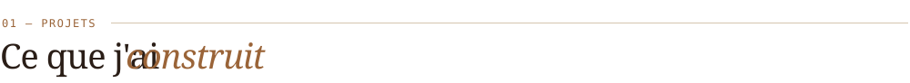
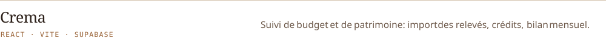
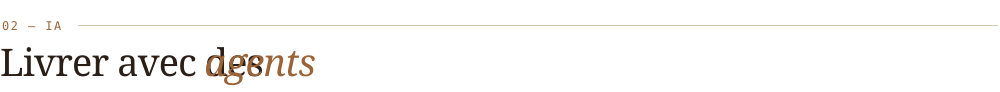
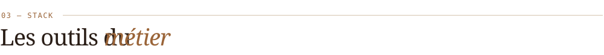
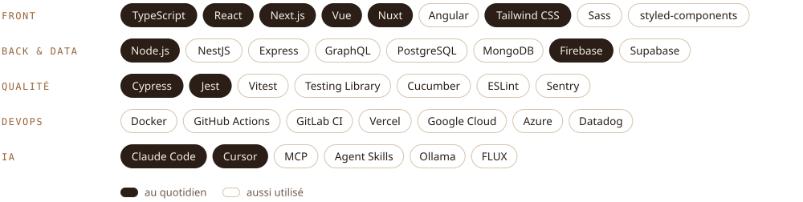
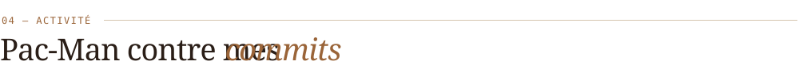

Développeur full-stack JavaScript basé à Lille, **plus de dix ans en ESN** pour le retail, l'immobilier, l'énergie et le transport. Aujourd'hui tech lead sur une plateforme métier de 7 000 utilisateurs : analyse de causes racines, correctifs en production, monitoring.

Disponible en **freelance** pour du build produit (MVP), du renfort d'équipe ou de l'audit.

<picture>
  <source media="(prefers-color-scheme: dark)" srcset="assets/h-projets-dark.svg" />
  
</picture>

<a href="https://badminton-manager.clamarque-dev.workers.dev/"><picture>
  <source media="(prefers-color-scheme: dark)" srcset="assets/p-badminton-dark.svg" />
  
</picture></a>
<a href="https://www.hubmovies.app/"><picture>
  <source media="(prefers-color-scheme: dark)" srcset="assets/p-hubmovies-dark.svg" />
  
</picture></a>
<a href="https://clamarque.github.io/#section-portfolio"><picture>
  <source media="(prefers-color-scheme: dark)" srcset="assets/p-contelune-dark.svg" />
  
</picture></a>
<a href="https://clamarque.github.io/#section-portfolio"><picture>
  <source media="(prefers-color-scheme: dark)" srcset="assets/p-crema-dark.svg" />
  
</picture></a>
<a href="https://github.com/clamarque/angular-movies"><picture>
  <source media="(prefers-color-scheme: dark)" srcset="assets/p-angular-movies-dark.svg" />
  
</picture></a>
<a href="https://github.com/clamarque/kibana_health_metric_vis"><picture>
  <source media="(prefers-color-scheme: dark)" srcset="assets/p-kibana-health-dark.svg" />
  
</picture></a>

<picture>
  <source media="(prefers-color-scheme: dark)" srcset="assets/h-ia-dark.svg" />
  
</picture>

- **Agents** — Claude Code et Cursor, subagents et workflows multi-agents : investigation, plan, implémentation, revue.
- **MCP** — agents connectés aux outils de l'équipe : GitLab, Jira, Datadog, MongoDB, Slack, Playwright.
- **Skills** — procédures d'équipe codifiées : du ticket à la merge request, revue de code locale, suivi de la santé prod.
- **IA locale** — Ollama et FLUX en local, sans dépendance cloud.

L'IA accélère l'exécution ; les choix d'architecture et la relecture restent humains.

<picture>
  <source media="(prefers-color-scheme: dark)" srcset="assets/h-stack-dark.svg" />
  
</picture>

<picture>
  <source media="(prefers-color-scheme: dark)" srcset="assets/stack-dark.svg" />
  
</picture>

<picture>
  <source media="(prefers-color-scheme: dark)" srcset="assets/h-activite-dark.svg" />
  
</picture>

<picture>
  <source media="(prefers-color-scheme: dark)" srcset="https://raw.githubusercontent.com/clamarque/clamarque/output/pacman-contribution-graph-dark.svg" />
  
</picture>

<picture>
  <source media="(prefers-color-scheme: dark)" srcset="assets/h-contact-dark.svg" />
  
</picture>

