

  

  &nbsp;
  &nbsp;
  

  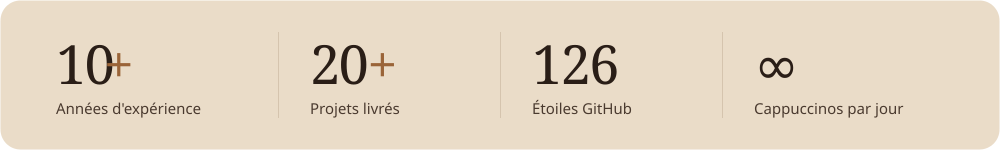

  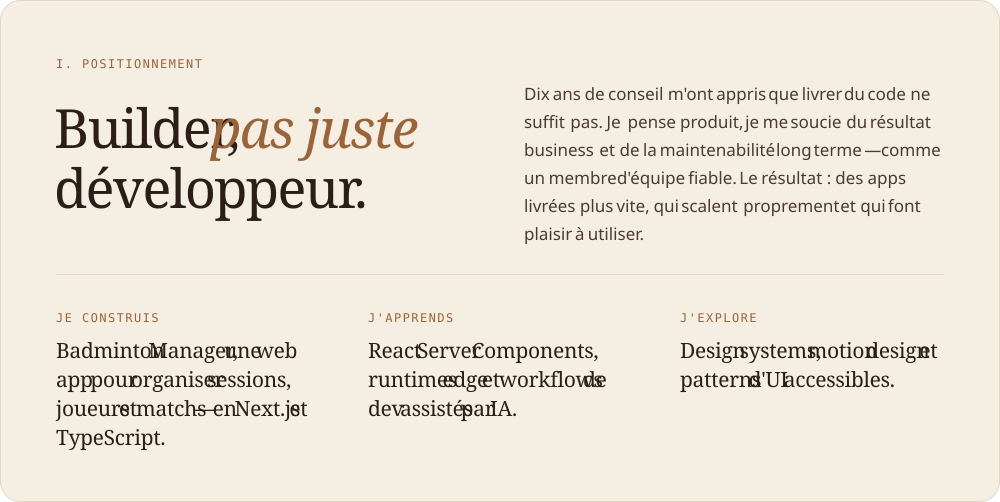

  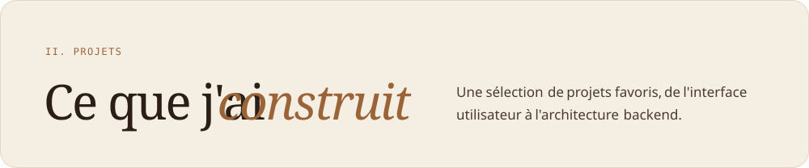

  <a href="https://badminton-manager.clamarque-dev.workers.dev/">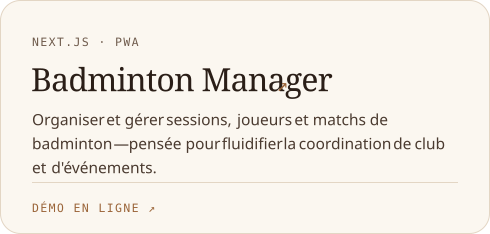</a>
  <a href="https://www.hubmovies.app/">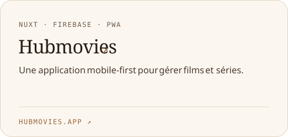</a>
  <a href="https://clamarque.github.io/#section-portfolio">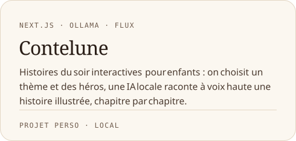</a>
  <a href="https://clamarque.github.io/#section-portfolio">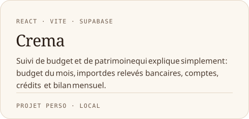</a>

  <a href="https://github.com/clamarque/angular-movies">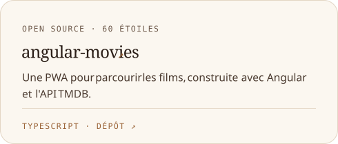</a>
  <a href="https://github.com/clamarque/kibana_health_metric_vis">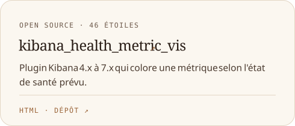</a>

  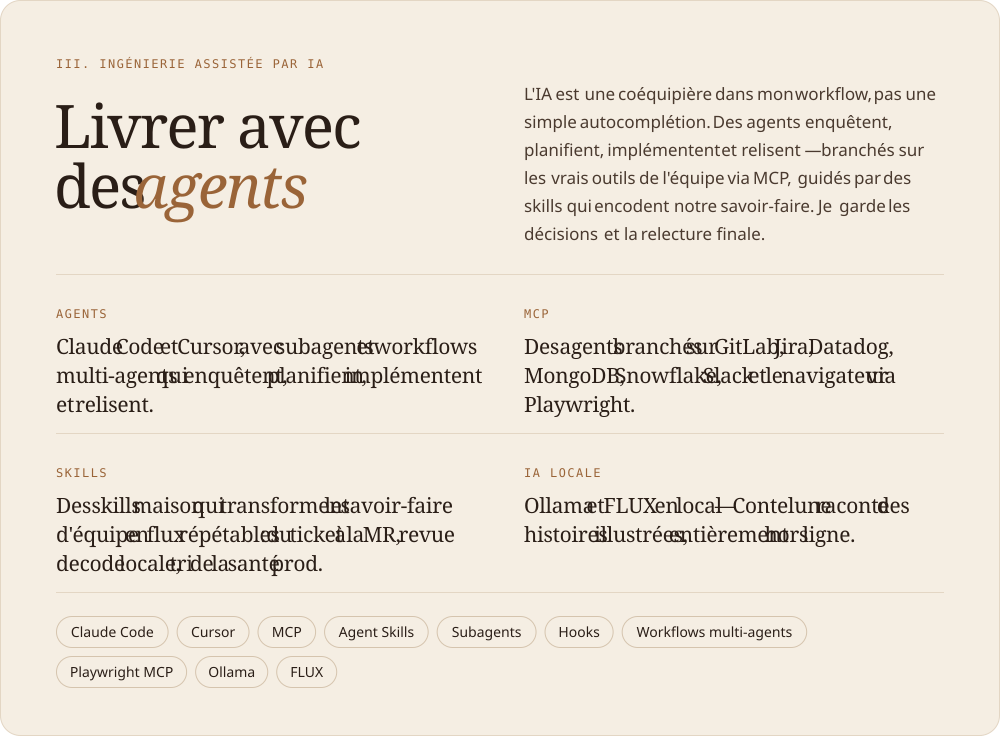

  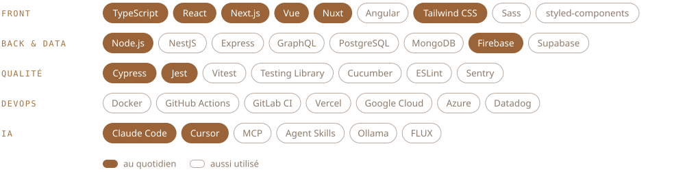

  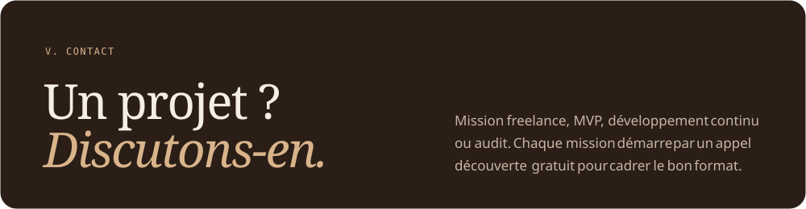

  <a href="mailto:clamarque.dev@gmail.com">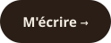</a>&nbsp;
  &nbsp;
  <a href="https://clamarque.github.io/">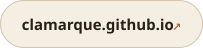</a>

