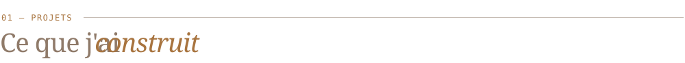
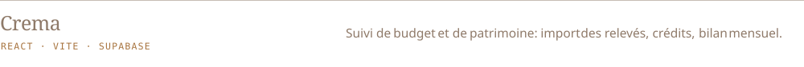
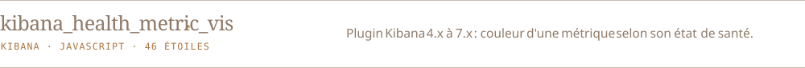
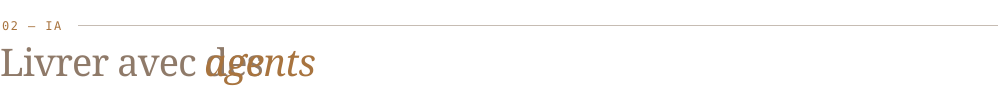
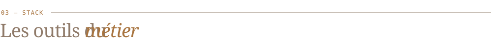
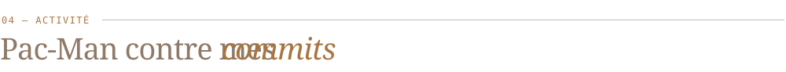
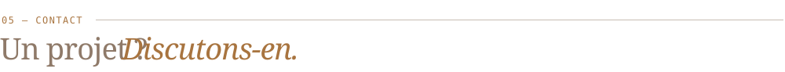

Développeur full-stack JavaScript basé à Lille, **plus de dix ans en ESN** pour le retail, l'immobilier, l'énergie et le transport. Aujourd'hui tech lead sur une plateforme métier de 7 000 utilisateurs : analyse de causes racines, correctifs en production, monitoring.

Disponible en **freelance** pour du build produit (MVP), du renfort d'équipe ou de l'audit.

- **Agents** — Claude Code et Cursor, subagents et workflows multi-agents : investigation, plan, implémentation, revue.
- **MCP** — agents connectés aux outils de l'équipe : GitLab, Jira, Datadog, MongoDB, Slack, Playwright.
- **Skills** — procédures d'équipe codifiées : du ticket à la merge request, revue de code locale, suivi de la santé prod.
- **IA locale** — Ollama et FLUX en local, sans dépendance cloud.

L'IA accélère l'exécution ; les choix d'architecture et la relecture restent humains.

